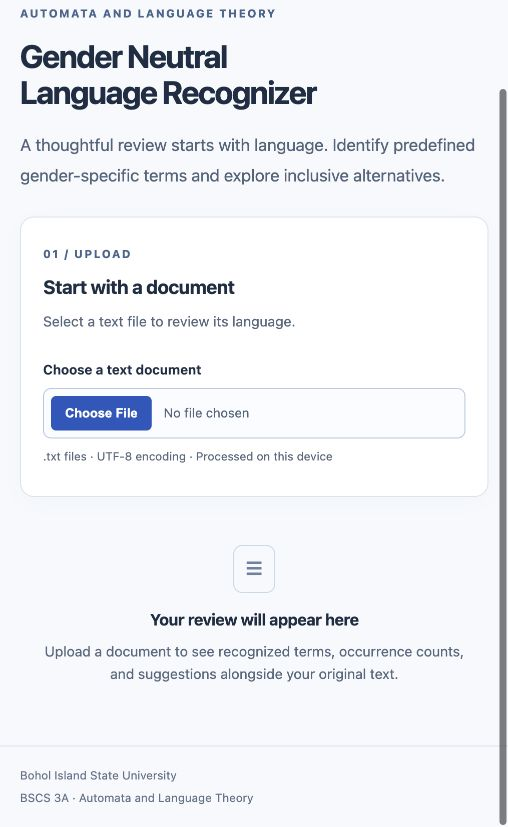
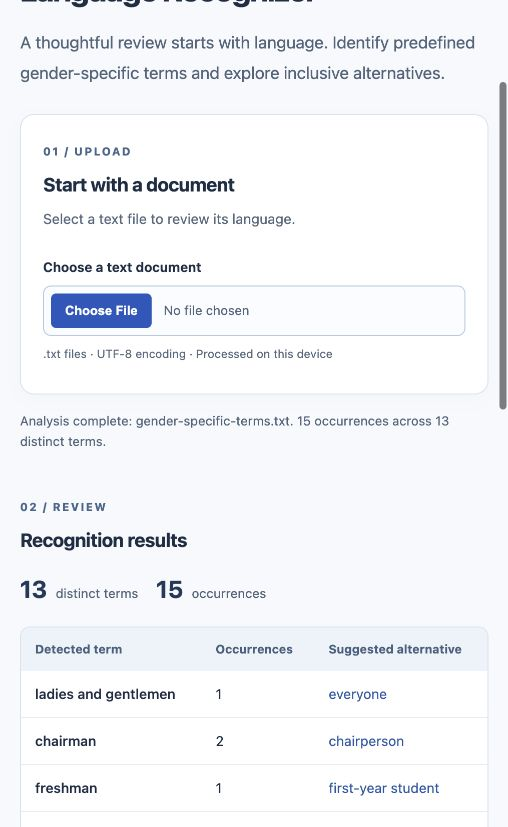
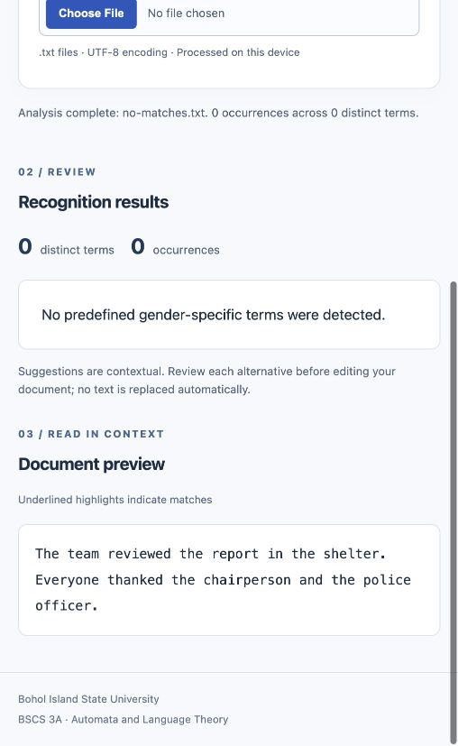

# Gender Neutral Language Recognizer — project report

**Bohol Island State University**

**Course:** Automata and Language Theory

**Section:** BSCS 3A

**Instructor:** ALMA MAE B. AUXTERO

**Members:** Leonardo Jose D. Galon Jr.; Jessica Mapute; Jade Melanie Acdal; Christian Olonan

**Prepared:** October 30, 2026, Philippine time

**Status:** Project report draft for member review; not a claim of submission.

## 1. Project overview

The application identifies a predefined vocabulary of gender-specific words and phrases in uploaded text documents. It reports occurrence counts and suggested alternatives while preserving the decoded original text in a highlighted preview. Its purpose is to demonstrate regular-expression recognition and support thoughtful manual language review, rather than decide whether language is appropriate in context.

Users select a UTF-8 `.txt` document, inspect the summary and table, and review each occurrence in context. Invalid extensions, unreadable files, invalid encoding, empty documents and whitespace-only input produce clear feedback. Replacing the file clears old results, and late read completions cannot overwrite a newer selection. All document processing occurs locally in the browser.

## 2. Tools and recognition approach

React functional components implement the interface. Strict TypeScript defines rules, matches, aggregate results, summaries and a discriminated file-processing state. Vite builds static assets; native browser APIs read files. Vitest and React Testing Library verify behavior; ESLint, Prettier and GitHub Actions support repeatable quality checks. npm uses a committed lockfile. No database, application backend, AI API or finite state automaton implementation is included.

### Actual regex construction

The source uses this template with the `giu` flags:

```ts
new RegExp(
  `(?<![\\p{L}\\p{M}\\p{N}_])(?:${alternatives.join('|') || '(?!)'})(?![\\p{L}\\p{M}\\p{N}_])`,
  'giu',
);
```

Each configured term is escaped with `value.replace(/[.*+?^${}()|[\]\\]/g, '\\$&')`. Terms are sorted by descending length; phrase words are joined with `[ \\t]+` in the construction string (producing `[ \t]+` in the regex). A representative generated pattern is:

```regex
(?<![\p{L}\p{M}\p{N}_])(?:ladies[ \t]+and[ \t]+gentlemen|chairwoman|chairman|man-made|he|she)(?![\p{L}\p{M}\p{N}_])
```

This representative pattern omits other alternatives for readability; the application includes every rule below.

- **Character classes:** `\p{L}` means Unicode letters, `\p{M}` combining marks, `\p{N}` numbers, and `_` the underscore. Treating marks as part of words avoids splitting decomposed accented text.
- **Whole-word boundaries:** negative lookbehind `(?<!...)` and negative lookahead `(?!...)` require that neighboring characters are not in those classes. They do not consume punctuation. Thus he matches in “He arrived” but not in “the”, “shelter”, “he2” or “éhe”.
- **Alternation:** `|` expresses alternatives inside a noncapturing group `(?:...)`. Longest-first order handles overlapping prefixes; metacharacters in configured terms are escaped to remain literal.
- **Case-insensitive matching:** `i` recognizes uppercase and lowercase variants. Canonical lowercase lookup keys collapse supported horizontal whitespace. Unicode simple folds for long s and Kelvin sign are mapped to the corresponding configured ASCII spelling.
- **Global matching:** `g` and `matchAll` enumerate successive nonoverlapping matches. `matchAll` does not advance the stored expression's scan position, so repeated calls are deterministic.
- **Unicode handling:** `u` enables Unicode property escapes and case handling. Match positions remain JavaScript UTF-16 offsets, not Unicode code-point counts.
- **Phrase recognition:** `[ \t]+` accepts one or more ordinary spaces or tabs. It deliberately does not cross newlines, paragraph breaks, or nonbreaking spaces.

Each match stores original text, canonical term, alternative, start offset and exclusive end offset. A map aggregates counts by canonical term in order of first appearance. The preview slices the original decoded string around these offsets and renders safe React text nodes and semantic `<mark>` elements. No HTML injection or automatic replacement is used.

### Predefined terms and suggested alternatives

| Predefined term      | Suggested alternative |
| -------------------- | --------------------- |
| chairman             | chairperson           |
| chairwoman           | chairperson           |
| policeman            | police officer        |
| policewoman          | police officer        |
| fireman              | firefighter           |
| firewoman            | firefighter           |
| stewardess           | flight attendant      |
| mankind              | humankind             |
| manpower             | workforce             |
| businessman          | businessperson        |
| businesswoman        | businessperson        |
| salesman             | sales representative  |
| saleswoman           | sales representative  |
| mailman              | mail carrier          |
| freshman             | first-year student    |
| he                   | they                  |
| she                  | they                  |
| ladies and gentlemen | everyone              |
| man-made             | artificial            |
| waitress             | server                |

These mappings are suggestions only. They do not guarantee grammatical agreement or suitability in every context.

## 3. Application screenshots

The following are genuine captures of the running application in a narrow responsive browser viewport. See [capture instructions](screenshots/README.md) for wider replacement captures.



**Figure 1.** The labeled UTF-8 text-file selection control and initial review area.



**Figure 2.** The primary sample yields 13 distinct terms and 15 occurrences, with the first table rows visible.



**Figure 3.** The no-match sample displays the required exact message and preserves the original text.

## 4. Testing

Executed locally on October 30, 2026, Philippine time, using Node.js 24.15.0 and Vitest. The automated suite contains **26 passing tests across 3 files**, with no failures. Tests use real `File` objects; the test environment supplies the missing jsdom `Blob.arrayBuffer` API through `FileReader`. Production uses native browser APIs.

| Test case                    | Expected result                                 | Actual result                                                              | Status |
| ---------------------------- | ----------------------------------------------- | -------------------------------------------------------------------------- | ------ |
| 1. Predefined terms          | All configured terms and suggestions recognized | 20 terms matched once each with the configured suggestions                 | Passed |
| 2. Mixed capitalization      | Variants aggregated                             | chairman, Chairman, CHAIRMAN aggregated as chairman: 3                     | Passed |
| 3. No predefined terms       | No he inside the; exact UI message              | No matches in the/shelter sentence; exact message rendered                 | Passed |
| 4. Empty file                | Clear empty-document error                      | Zero-byte file rejected; UI error also verified                            | Passed |
| 5. Unsupported extension     | Clear unsupported-format error                  | PDF extension rejected; prior results cleared                              | Passed |
| 6. Punctuation               | Terms beside punctuation recognized             | Four matches in quotes, parentheses, semicolon and slash input             | Passed |
| 7. Embedded terms            | No partial-word matches                         | Letter, number, underscore and combining-mark cases rejected               | Passed |
| 8. Multiword phrase          | Spaces/tabs supported, line breaks rejected     | One supported phrase matched; newline-separated phrases rejected           | Passed |
| 9. Multiple-term counts      | Exact totals                                    | he: 2, chairman: 2, she: 1; total 5, distinct 3                            | Passed |
| 10. Highlight reconstruction | Original string unchanged                       | Preview textContent exactly equals input, including CRLF, emoji and spaces | Passed |
| 11. HTML-like content        | Literal safe text                               | No script or image element created; text preserved                         | Passed |
| 12. Replacement uploads      | New results replace old results                 | Repeated file accepted; second upload replaces first                       | Passed |
| 13. Whitespace-only file     | Clear error                                     | Whitespace-only UTF-8 rejected                                             | Passed |
| 14. Uppercase extension      | TXT accepted                                    | Uppercase filename accepted; original line endings retained                | Passed |
| 15. Invalid UTF-8            | Clear encoding error                            | Invalid byte sequence rejected                                             | Passed |

Additional passing assertions cover deterministic calls, UTF-16 offsets after emoji, escaped regex metacharacters, longest-first alternatives, empty/duplicate rule configurations, Unicode case folding, BOM removal, failed reads, recovery after invalid files, and a slow upload completing after a newer one.

Browser verification confirmed that the app launches, the primary sample produces **15 occurrences / 13 distinct terms**, and replacing it with the no-match sample produces **0 / 0** and the exact message. The responsive narrow layout was visually inspected. Screenshots above record these observations. Full cross-browser, assistive-technology and large-document performance testing has not been performed.

Quality gate results are recorded in `validation.md` after execution. CI runs the same gates on pushes and pull requests.

### Focused code review

Reviewed production types, rules, regex construction and lookup, file handling, state transitions, presentation, safe highlighting, and responsive CSS against correctness, security, accessibility and maintainability requirements. Unicode marks are included in boundaries, and Unicode case folds are handled during lookup. Upload request IDs prevent stale asynchronous results. Semantic text rendering avoids script execution. No critical or high-severity unresolved findings were identified. Large-file main-thread processing and limited browser coverage remain documented limitations, not verified performance guarantees.

## 5. Conclusion

The implementation demonstrates regular-expression recognition for a fixed vocabulary, accurate occurrence aggregation, and a position-preserving preview. Automated tests verify the five instructor cases and additional edge cases. It provides suggestions for human review without changing or transmitting uploaded content. It does not understand context, infer vocabulary variants, or guarantee grammar; very large files may reduce responsiveness. The report and member contribution details require student review before submission.

## 6. Sources and contributions

Technical references:

- [React documentation](https://react.dev/learn): components, state and text rendering.
- [TypeScript TSConfig reference](https://www.typescriptlang.org/tsconfig/): strict type checking.
- [Vite guide](https://vite.dev/guide/): development and production builds.
- [Vitest guide](https://vitest.dev/guide/): test execution.
- [Testing Library documentation](https://testing-library.com/docs/react-testing-library/intro/): behavior-oriented component tests.
- [MDN regular expressions](https://developer.mozilla.org/en-US/docs/Web/JavaScript/Guide/Regular_expressions): flags, classes, alternation and assertions.
- [MDN TextDecoder](https://developer.mozilla.org/en-US/docs/Web/API/TextDecoder): UTF-8 decoding and fatal errors.

The supplied project request is the authoritative assignment specification; no separate original guide or academic template was present in the initially empty workspace. The six-section report structure follows that request.

**AI disclosure:** OpenAI Codex assisted with architecture, code generation, automated tests, debugging, focused review, documentation and genuine screenshot capture. Students must review and understand the work and follow their institution's disclosure requirements.

| Member                     | Confirmed contribution (complete after member review) |
| -------------------------- | ----------------------------------------------------- |
| Leonardo Jose D. Galon Jr. | To be confirmed by the member                         |
| Jessica Mapute             | To be confirmed by the member                         |
| Jade Melanie Acdal         | To be confirmed by the member                         |
| Christian Olonan           | To be confirmed by the member                         |
